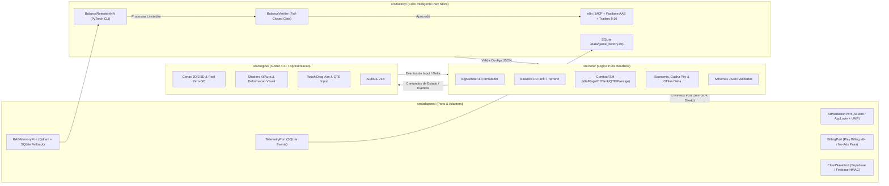

# ARQUITETURA VIVA — PLAYFORGE / TITAN SAIYAN: IDLE CLASH

> **Status Atual:** `Bloco 1 Arquivado (002 & 003) | Sprint 4A Arquivado (005) | Sprint 4B Arquivado (006 — Zaikor: Zenkai Infinite)` | **Próximo:** `Sprint 4C / OpenSpec 007 (AdMob+UMP, Play Billing v6+, Supabase & Android .aab)`  
> **Contrato Regente:** [AGENTS.md](../AGENTS.md)

---

## 1. Visão Geral do Sistema

O projeto adota uma **Arquitetura Hexagonal Dual (Cliente Mobile + Fábrica Inteligente Data-Driven)** projetada para operar com:
- **Núcleo de Regras 100% Puro e Headless (`src/core/`):** determinístico, offline, zero alocação desnecessária, testável via CLI em `< 1s`.
- **Borda de Engine e SDKs Desacoplada (`src/engine/` & `src/adapters/`):** Godot 4.3+ recomendado para builds Android enxutos (`.aab`), shaders neon/aura e mediação de anúncios/IAP via contratos explícitos (*Ports & Adapters*).
- **Fábrica Data-Driven & Quality Gate Fail-Closed (`src/factory/`):** simulador headless (`BalanceVerifier`), banco de telemetria SQLite (`data/game_factory.db`), memória RAG (Qdrant + fallback SQLite), otimizador neural (`BalanceRetentionNN`) e pipeline automatizado de publicação na Google Play Store.

---

## 2. Mapa de Diretórios do Repositório

| Caminho | Responsabilidade | Regra de Isolamento |
| :--- | :--- | :--- |
| `AGENTS.md` | Contrato central de engenharia, 4 Mentores e Play Store | Documento normativo raiz |
| `openspec/changes/` | Propostas ativas de mudança e SDDs (`00X-*.md`) | Obrigatório antes de qualquer código |
| `openspec/archive/` | Especificações implementadas, verificadas e congeladas | Promovido somente na Etapa 4 |
| `docs/ARQUITETURA.md` | Memória arquitetural viva, decisões e changelog | Atualizado a cada promoção OpenSpec |
| `src/core/` | Matemática `BigNumber`, balística DDTank, FSM, Gacha, Prestígio, Offline | **Zero** imports de engine, rede ou env global |
| `src/adapters/` | Interfaces (*Ports*) e implementações (*Adapters*) de Ads, Billing, Cloud, SQLite, RAG, MCP | Contratos testáveis com mocks isolados; falha fecha o gate |
| `src/engine/` | Cenas Godot 4.3+, shaders de Ki, partículas, áudio, UI e pools | Sem fórmulas de negócio ou estado autoritativo |
| `src/factory/` | `BalanceVerifier`, ETL SQLite, indexador RAG, `BalanceRetentionNN`, scripts Fastlane/9:16 | Rodam offline/CI sem depender de editor gráfico |
| `tests/unit/` | Testes unitários puros, determinísticos e rápidos (`< 1s`) | 100% offline; cobrem `src/core/` e invariantes |
| `tests/integration/` | Simulações headless longas, contratos de adapters e auditoria de manifest/build | Gate *fail-closed* pré-`.aab` |
| `data/` | Armazenamento local em runtime (`game_factory.db`, índices locais) | Binários `.db` e vetores ignorados pelo `.gitignore` |

---

## 3. Garantias Arquiteturais Transversais

### 3.1 Determinismo e Testabilidade (`src/core/`)
- **Relógio Injetável (`now_utc_ms: int`):** Nenhum cálculo de ganho offline, cooldown de boost ou janela QTE lê `Time.now()` ou relógio do SO diretamente dentro do núcleo.
- **PRNG Seedável (`SeededRNG`):** Gacha, chance crítica, vento dinâmico e variações de boss recebem semente explícita para reprodução exata de bugs em testes unitários e simulações do `BalanceVerifier`.
- **Configuração Hermética:** Toda a progressão reside em arquivos JSON tipados e validados na inicialização; testes instanciam configs isoladas sem ler variáveis de ambiente globais.

### 3.2 Performance Mobile (`Zero GC Alloc` em 60/120 FPS)
- **Buffers Pré-Alocados:** A curva de previsão do *Guia Laser DDTank*, lista de projéteis ativos, números flutuantes de dano (`K/M/B/T/Qa/Qi`) e histórico de impactos operam sobre arrays/pools fixos inicializados fora do loop de frame.
- **Sub-Stepping Determinístico:** A integração da balística e colisão contínua (segmento-círculo) evita *tunneling* mesmo em velocidades extremas de Ki sem exigir física pesada de corpo rígido por frame.

### 3.3 Segurança, Anti-Tamper e Conformidade Play Store (*Fail-Closed*)
- **UMP Consent (LGPD/GDPR):** O adaptador de mediação (`AdMediationPort`) bloqueia qualquer requisição de anúncio personalizado ou não-consentido até resposta explícita válida do fluxo UMP.
- **Rewarded Ads & `No-Ads Pass`:**
  - Recompensa só é concedida mediante callback verificado `REWARD_EARNED` do SDK **ou** entitlement ativo e verificado do SKU `no_ads_pass` via `BillingPort`.
  - `BillingPort` exige fluxo obrigatório de `Restore Purchases`, `acknowledge` idempotente (deduplicado por `transaction_id`) e falha fechada em erro de assinatura/recibo.
- **Anti-Exploit de Relógio Offline:** Deltas negativos (`now < last_seen`) são rejeitados (`reward = 0` + evento de anomalia) e deltas positivos sofrem teto rígido (`28.800s` = 8h).
- **Cloud Save Assinado:** Envelopes JSON enviados pelo `CloudSavePort` carregam versão monotônica (`version_seq`) e assinatura HMAC/hash de integridade para impedir adulteração trivial de moeda/diamantes offline.
- **Transparência de Gacha:** Todas as tabelas de probabilidade são declaradas em JSON auditado (`sum(probs) == 1.0`) e expostas na UI conforme políticas da Google Play Store.

---

## 4. Registro OpenSpec & Changelog Arquitetural

| ID | Especificação | Status | Resumo |
| :--- | :--- | :--- | :--- |
| `001` | [001-core-architecture-and-ballistics.md](../openspec/changes/001-core-architecture-and-ballistics.md) | `APPROVED` (Arquitetura Mestre) | Arquitetura base `16:9` Paisagem, `Godot 4.4+ GDScript`, contratos JSON, `BigNumber`, balística DDTank (`v_max=1650`, `wind_accel_factor=2.2`), `CombatFSM`, `AdMob+UMP+Supabase` e fábrica em 3 blocos. |
| `002` | [002-bignum-and-ddtank-ballistics.md](../openspec/archive/002-bignum-and-ddtank-ballistics.md) | `ARCHIVED` (`v0.1.0-core-a`) | **Passo 2A entregue:** `BigNum`, `BalanceConfig` + `balance_v1.json`, `TerrainHeightmap` (`Zero GC`) e `DDTankBallistics` (`1.320` cenários `HEAD_CORE 10x` + Guia Laser). Validado offline: `75` assertions, `0` falhas em `248.16 ms`. |
| `003` | [003-economy-fsm-and-balance-verifier.md](../openspec/archive/003-economy-fsm-and-balance-verifier.md) | `ARCHIVED` (`v0.2.0-core-b`) | **Passo 2B / Bloco 1 entregue:** `SeededRng`, `IdleEconomy` (Gacha pity `50`, Offline 8h anti-tamper, Prestígio sem exploit de estágio `1`), `CombatFsm` e `BalanceVerifier` headless 72h (*fail-closed*). Validado offline: `191` assertions (`203.94 ms`, `0` falhas) e 72h x 3 perfis aprovados (`F2P_PURE=274`, `F2P_REWARDED=289`, `NO_ADS_PASS=288`, `max_stall=88.0s`). |
| `004` | [004-gow-2d-action-magic-game.md](../openspec/changes/004-gow-2d-action-magic-game.md) | `APPROVED` (Jogo 1 — Foco Atual) | **Pivô focado aprovado:** Primeiro entregar 1 jogo completo 2D lateral Dark Fantasy (estilo *God of War*) com silhuetas de alto contraste, combos, 4 magias, mundos interconectados, Altares de Salvamento e Chefes Titânicos em Sprints `4A ➔ 4B ➔ 4C`. |
| `005` | [005-action-world-combat-core.md](../openspec/archive/005-action-world-combat-core.md) | `ARCHIVED` (`v0.3.0-core-action`) | **Sprint 4A entregue:** `action_world_v1.json` (2 Mundos / 8 salas interconectadas), `ActionWorldConfig`, `ActionCombatCore` (2D plataforma, *dash i-frames*, combos 3 hits, 4 magias elementais, postura/QTE, Altares de Salvamento, snapshot) e `ActionBalanceVerifier`. Validado offline: `229` assertions (`615.85 ms`, `0` falhas) e travessia 20Hz aprovada (`741.30 ms`, `worlds=2`, `rooms=8`, `altars=2`, `dodges>=10`, `qtes>=10`). |
| `006` | [006-gow-2d-dark-fantasy-godot-scene.md](../openspec/archive/006-gow-2d-dark-fantasy-godot-scene.md) | `ARCHIVED` (`v0.4.0-playable-slice`) | **Sprint 4B entregue:** Cliente jogável `Zaikor: Zenkai Infinite` (`1920x1080` / janela `1280x720` Godot 4.4), silhuetas Dark Fantasy, VFX `Zero GC Alloc`, 16 SFX procedurais WAV, Tela Título (`Continuar`/`Novo Jogo`), Altares/Forja/Gacha, Touch + Teclado e persistência `user://checkpoint_v1.json`. Validado headless: `14` assertions engine (`0` SCRIPT ERROR) + `229` unitários (`750.23 ms`) + `ActionBalanceVerifier` (`F2P_PURE=64.2s`, `F2P_REWARDED=66.6s`). |
