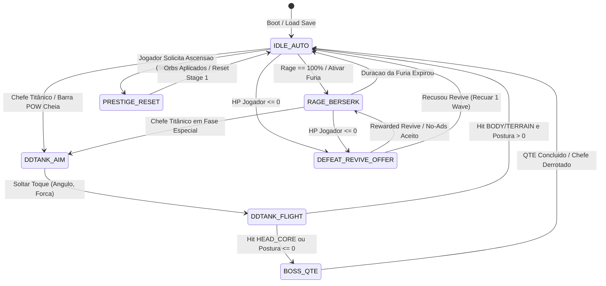
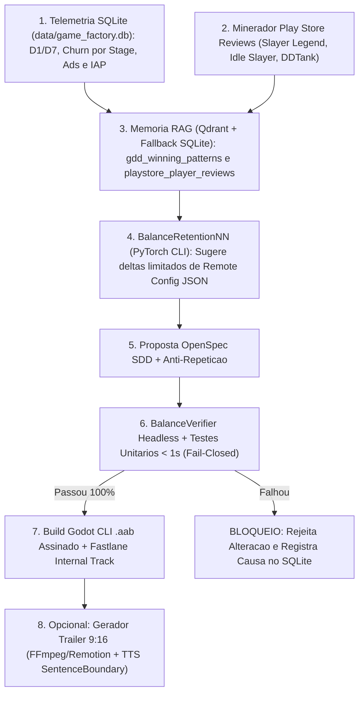

# OpenSpec Change 001: Arquitetura Core, Economia Data-Driven, Balística DDTank e Fábrica Play Store

- **ID:** `001-core-architecture-and-ballistics`
- **Status:** `APPROVED_IN_EXECUTION` *(Decisões aprovadas e toolchain `Godot 4.4-stable` provisionada em `tools/godot/`; executando via Changes incrementais `002+`)*
- **Autor:** Equipe de Engenharia PlayForge (Mentor de Planejamento & SDD)
- **Alvo:** PlayForge Factory + Jogo Âncora **TITAN SAIYAN: IDLE CLASH**
- **Regra Violável?** NÃO. Nenhuma linha de código de produção (`src/core/`, `src/engine/`, `src/adapters/`, `src/factory/`) deve ser escrita antes da confirmação final do ambiente CLI da Etapa 2A.

---

## 1. Objetivo e Escopo

Estabelecer a fundação arquitetural e os contratos matemáticos/JSON formais do projeto antes de escrever scripts de engine:
1. **Contratos de Dados JSON (`src/core/`)** para toda progressão idle, 5 transformações de Ki, armas/auras/espíritos (Gacha com *pity*), Prestígio, ganho offline e parâmetros balísticos DDTank.
2. **Núcleo Matemático Puro (`src/core/`)**: aritmética `BigNumber` livre de overflow/`NaN`, loop de combate determinístico, balística parabólica com vento dinâmico, zonas de acerto crítico (`POW! 10x`) e deformação lógica de terreno.
3. **Máquina de Estados de Combate (`CombatFSM`)** unificando o loop *Idle* 24/7, *Fúria Berserk*, *Disparo DDTank*, *QTE Finisher* em Chefes Titânicos, *Revive* e *Ascensão/Prestígio*.
4. **Interfaces de Borda (`src/adapters/`)**: contratos *fail-closed* para Mediação de Anúncios + UMP (`AdMediationPort`), Google Play Billing v6+ (`BillingPort`), Cloud Save anti-tamper (`CloudSavePort`), Telemetria SQLite (`TelemetryPort`) e Memória RAG (`RAGMemoryPort`).
5. **Verificador Headless (`BalanceVerifier`) & Ciclo de Fábrica (`src/factory/`)** para auditar balanço econômico antes do build `.aab` e retroalimentar versões via Telemetria + RAG + `BalanceRetentionNN` + Fastlane + Trailers 9:16.

**Fora de escopo nesta Change `001`:** implementação de cenas visuais Godot, shaders, arte/sprites, integração real com SDKs nativos Android ou compilação de `.aab`.

---

## 2. Contratos de Dados JSON Declarativos (`src/core/`)

Toda mecânica, curva de custo, chefe e banner de Gacha reside em arquivos JSON validados na inicialização (schema estrito, rejeição *fail-closed* em caso de campo ausente ou invariante violado).

### 2.1 Contrato Mestre `GameBalanceConfig` (Exemplo Estrutural)

```json
{
  "schema_version": "1.0.0",
  "bignum_format": {
    "decimal_places": 2,
    "suffixes": ["", "K", "M", "B", "T", "Qa", "Qi", "Sx", "Sp", "Oc", "No", "Dc"]
  },
  "upgrade_curves": {
    "attack": {
      "base_value": 12.0,
      "growth_linear": 4.5,
      "growth_exp": 1.075,
      "base_cost": 10.0,
      "cost_ratio": 1.14,
      "hard_cap_level": null
    },
    "crit_rate": {
      "base_value": 0.05,
      "growth_linear": 0.0025,
      "growth_exp": 1.0,
      "base_cost": 25.0,
      "cost_ratio": 1.22,
      "hard_cap_value": 1.0,
      "overflow_to_crit_dmg_ratio": 2.0
    },
    "crit_damage": {
      "base_value": 1.5,
      "growth_linear": 0.08,
      "growth_exp": 1.02,
      "base_cost": 30.0,
      "cost_ratio": 1.16,
      "hard_cap_level": null
    },
    "attack_speed": {
      "base_value": 1.0,
      "growth_linear": 0.015,
      "growth_exp": 1.0,
      "base_cost": 40.0,
      "cost_ratio": 1.25,
      "hard_cap_value": 4.0
    },
    "penetration": {
      "base_value": 0.0,
      "growth_linear": 3.0,
      "growth_exp": 1.06,
      "base_cost": 50.0,
      "cost_ratio": 1.18,
      "hard_cap_level": null
    }
  },
  "ki_transformations": [
    {
      "id": "BASE",
      "tier": 1,
      "display_name": "Guerreiro Base",
      "unlock_stage": 1,
      "ki_cost": 0,
      "atk_mult": 1.0,
      "spd_mult": 1.0,
      "crit_dmg_bonus": 0.0,
      "aura_shader_preset": "aura_none",
      "hair_palette_id": "obsidian"
    },
    {
      "id": "PRIMAL_FURY",
      "tier": 2,
      "display_name": "Furia Primitiva",
      "unlock_stage": 15,
      "ki_cost": 100,
      "atk_mult": 2.5,
      "spd_mult": 1.15,
      "crit_dmg_bonus": 0.5,
      "aura_shader_preset": "aura_crimson_sparks",
      "hair_palette_id": "crimson_dark"
    },
    {
      "id": "SUPER_SAIYAN",
      "tier": 3,
      "display_name": "Super Saiyajin",
      "unlock_stage": 50,
      "ki_cost": 300,
      "atk_mult": 8.0,
      "spd_mult": 1.35,
      "crit_dmg_bonus": 1.5,
      "aura_shader_preset": "aura_solar_gold",
      "hair_palette_id": "gold_neon"
    },
    {
      "id": "DIVINE_GOD",
      "tier": 4,
      "display_name": "Divino",
      "unlock_stage": 150,
      "ki_cost": 750,
      "atk_mult": 32.0,
      "spd_mult": 1.6,
      "crit_dmg_bonus": 4.0,
      "aura_shader_preset": "aura_cyan_plasma",
      "hair_palette_id": "cyan_divine"
    },
    {
      "id": "ULTRA_INSTINCT",
      "tier": 5,
      "display_name": "Ultra Instinto",
      "unlock_stage": 400,
      "ki_cost": 1500,
      "atk_mult": 160.0,
      "spd_mult": 2.0,
      "crit_dmg_bonus": 10.0,
      "aura_shader_preset": "aura_silver_void",
      "hair_palette_id": "silver_astral"
    }
  ],
  "gacha_banners": [
    {
      "banner_id": "weapons_mythic_v1",
      "category": "WEAPON",
      "single_cost_gems": 50,
      "ten_pull_cost_gems": 450,
      "daily_ad_ten_pull_cap": 3,
      "pity_hard_threshold": 50,
      "pity_guaranteed_min_rarity": "MYTHIC",
      "probabilities": {
        "COMMON": 0.55,
        "RARE": 0.28,
        "EPIC": 0.12,
        "LEGENDARY": 0.04,
        "MYTHIC": 0.01
      }
    }
  ],
  "prestige_config": {
    "min_stage_required": 50,
    "base_divisor": 50.0,
    "stage_exponent": 1.45,
    "soul_orb_scale": 10.0,
    "per_orb_atk_bonus": 0.25,
    "per_orb_gold_bonus": 0.15
  },
  "offline_rewards_config": {
    "min_claim_seconds": 60,
    "max_offline_seconds": 28800,
    "efficiency_ratio": 0.6,
    "dragon_chest_ad_multiplier": 3.0
  },
  "ddtank_ballistics_config": {
    "orientation": "LANDSCAPE_16_9",
    "arena_logical_width": 1920.0,
    "arena_logical_height": 1080.0,
    "player_anchor_x": 220.0,
    "boss_anchor_x_min": 1320.0,
    "boss_anchor_x_max": 1580.0,
    "gravity": 980.0,
    "v_min": 350.0,
    "v_max": 1650.0,
    "angle_min_deg": 5.0,
    "angle_max_deg": 85.0,
    "wind_min": -100.0,
    "wind_max": 100.0,
    "wind_accel_factor": 2.2,
    "fixed_dt": 0.0083333333,
    "max_flight_seconds": 8.0,
    "crater_radius_px": 56.0,
    "head_core_multiplier": 10.0,
    "body_multiplier": 1.0,
    "limb_glancing_multiplier": 0.5,
    "laser_guide_points": 48,
    "laser_guide_dt": 0.045
  },
  "enemy_stage_config": {
    "waves_per_stage": 5,
    "hp_base": 45.0,
    "hp_stage_ratio": 1.24,
    "armor_base": 2.0,
    "armor_stage_ratio": 1.12,
    "gold_base": 8.0,
    "gold_stage_ratio": 1.18,
    "boss_hp_multiplier": 12.0,
    "titanic_boss_every_n_stages": 5,
    "titanic_posture_max": 100.0,
    "qte_window_ms": 2500,
    "boss_enrage_seconds": 45.0
  },
  "monetization_placements": {
    "no_ads_sku": "no_ads_pass",
    "rewarded_placements": [
      "dragon_chest_offline_3x",
      "fury_of_gods_20m_boost",
      "daily_gacha_10x_free",
      "boss_instant_revive_full_pow",
      "ddtank_atomic_laser_guide"
    ]
  }
}
```

### 2.2 Invariantes Obrigatórios dos Contratos JSON
1. `sum(probabilities.values()) == 1.0` (tolerância máxima `1e-9`) e `pity_hard_threshold >= 1`.
2. `max_offline_seconds <= 28800` (8h), `dragon_chest_ad_multiplier >= 1.0`, `0.0 < efficiency_ratio <= 1.0`.
3. `angle_min_deg < angle_max_deg`, `v_min < v_max`, `gravity > 0`, `fixed_dt > 0`, `head_core_multiplier == 10.0`.
4. `ki_transformations` ordenadas estritamente por `tier` crescente com `atk_mult >= 1.0`.
5. Qualquer erro de schema aborta o boot do verificador/jogo (*fail-closed*).

---

## 3. Especificação Matemática Pura (`src/core/`)

### 3.1 BigNumber (`BigNum`) — Escala Cósmica Determinística
Para evitar estouro do limite IEEE-754 (`~1.8e308`) e eliminar `NaN`/`Inf` em estágios avançados:

- **Representação Canônica:** par imutável `(m: float64, e: int64)`:
  - Zero canônico: `(0.0, 0)`.
  - Qualquer valor positivo finito: $V = m \times 10^{e}$, com invariante $1.0 \le m < 10.0$ e $e \in [-10^{15}, +10^{15}]$.
  - Valores negativos são rejeitados em quantidades não-assinadas (ouro, HP, dano) ou lançam erro explícito na validação de entrada.
- **Normalização ($O(1)$ com guard):**
  - Rejeita `isnan(m)` ou `isinf(m)`.
  - Ajusta potências de 10 até $m \in [1.0, 10.0)$ (caso `abs(m) < 1e-15`, colapsa para zero canônico `(0.0, 0)`).
- **Operações Principais:**
  - `add(a, b)`: se $|e_a - e_b| > 15$, retorna o maior sem perda de precisão catastrófica; caso contrário alinha ao maior expoente e soma as mantissas.
  - `sub_clamped(a, b)`: retorna $\max(0, a - b)$ garantindo que HP e moedas jamais fiquem negativos.
  - `mul(a, b)`: $(m_a \cdot m_b,\; e_a + e_b)$ seguido de normalização.
  - `div(a, b)`: erro explícito se $b = 0$; caso contrário $(m_a / m_b,\; e_a - e_b)$ normalizado.
  - `pow_ratio(base, exp_int)`: exponenciação por quadratura em `BigNum` usando `log10` controlado apenas para expoentes fracionários positivos, sempre normalizando e verificando finitude.
- **Formatação Visual:**
  - Para $e < 3$: inteiro/decimal direto.
  - Para $e \ge 3$: índice de sufixo $k = \lfloor e / 3 \rfloor$. Se $k < \text{len(suffixes)}$, exibe $(m \times 10^{e \bmod 3})$ + `suffixes[k]` (ex.: `1.54Qa`, `820.10Qi`). Acima do último sufixo, exibe notação científica `1.54e39`.

### 3.2 Progressão Idle, Dano e Ganho Offline
- **Valor de Atributo no Nível $L \ge 0$:**
  $$V(L) = (V_0 + g_{\text{lin}} \cdot L) \cdot g_{\text{exp}}^{L}$$
- **Custo do Nível $L \to L+1$ e Compra em Lote ($n$ níveis em $O(1)$):**
  $$C(L) = C_0 \cdot r^{L}, \qquad C_{\text{total}}(L, n) = \begin{cases} C_0 \cdot r^{L} \cdot n, & r = 1 \\ C_0 \cdot r^{L} \cdot \dfrac{r^{n} - 1}{r - 1}, & r > 1 \end{cases}$$
  *(Cálculo executado integralmente em `BigNum` para suportar compras 100x em estágios $10^{50}+$ sem overflow).*
- **Dano Efetivo por Golpe:**
  $$\text{Atk}_{\text{total}} = V_{\text{atk}}(L_{\text{atk}}) \cdot M_{\text{arma}} \cdot M_{\text{aura}} \cdot M_{\text{esp}} \cdot M_{\text{Ki}} \cdot M_{\text{Fúria}} \cdot M_{\text{Prestígio}}$$
  $$\text{Mitigação} = \frac{1}{1 + \max(0,\; \text{Armor}_{\text{boss}} - \text{Pen}_{\text{player}}) / K_{\text{armor}}}$$
  $$\text{Dano} = \text{Atk}_{\text{total}} \cdot \text{Mitigação} \cdot \text{CritMult}$$
  *(Se `crit_rate > 1.0`, o excedente converte em bônus de `crit_damage` via `overflow_to_crit_dmg_ratio`, preservando valor de cada upgrade).*
- **Ganho Offline por Delta de Timestamp (Anti-Exploit):**
  - Entrada: `last_seen_utc_ms`, `now_utc_ms`, `dps_stage_rate`, `claimed_with_ad_or_noads`.
  - Se `now_utc_ms < last_seen_utc_ms`: retorna `reward = 0` e sinaliza `ClockTamperDetected`.
  - Caso contrário:
    $$\Delta t = \min\left(\frac{\text{now\_utc\_ms} - \text{last\_seen\_utc\_ms}}{1000},\; 28800\right)$$
    $$\text{Loot} = \begin{cases} 0, & \Delta t < 60 \\ \text{gold\_per\_sec} \cdot \Delta t \cdot \text{efficiency\_ratio} \cdot M_{\text{baú}}, & \Delta t \ge 60 \end{cases}$$
    onde $M_{\text{baú}} = 3.0$ se ativado *Baú do Dragão* (Rewarded Ad validado ou `No-Ads Pass`), caso contrário $1.0$.

### 3.3 Balística Parabólica DDTank, Vento e Deformação Lógica
Toda a física em `src/core/` usa sistema cartesiano puro ($+x$ para a direita em direção ao chefe, $+y$ para cima; o adaptador da engine converte para coordenadas de tela Godot $-y$).

- **Equações de Movimento com Vento Dinâmico ($w \in [-100, +100]$):**
  $$a_x = w \cdot \kappa_w, \qquad a_y = -g$$
  $$x(t) = x_0 + v_0 \cos(\theta)\, t + \frac{1}{2} a_x t^2$$
  $$y(t) = y_0 + v_0 \sin(\theta)\, t - \frac{1}{2} g t^2$$
  *(Com $\theta \in [\theta_{\min}, \theta_{\max}]$ radianos, $v_0 \in [v_{\min}, v_{\max}]$).*
- **Integração Sub-Stepped & Detecção Contínua (Zero Tunneling):**
  - Simulação avança em passos fixos $\Delta t = 1/120\,\text{s}$ gerando segmentos $[P_k, P_{k+1}]$.
  - A colisão testa interseção de segmento com círculos/cápsulas na ordem de prioridade:
    1. **`HEAD_CORE` (Núcleo / Cabeça do Chefe):** ativa **"POW! CRÍTICO NUCLEAR (`10.0x` Dano)"** + `60%` de quebra de postura imediata.
    2. **`BODY` (Corpo do Chefe):** `1.0x` dano + `20%` de quebra de postura.
    3. **`LIMB_GLANCING` (Membro / Escudo):** `0.5x` dano + `10%` de quebra de postura.
    4. **`TERRAIN` (Solo Destrutível):** se $y_{k+1} \le \text{terrain\_height}(x_{k+1})$, calcula ponto de impacto interpolado $(x_{\text{imp}}, y_{\text{imp}})$ e escava cratera lógica.
- **Deformação Lógica do Terreno (`TerrainHeightmap`):**
  - Representada em `src/core/` por array fixo pré-alocado $H[0 \dots N-1]$ de alturas amostradas a cada $\Delta x$ pixels (ex.: $N = 256$, Zero GC Alloc).
  - Ao explodir uma cratera de raio $R$ centrada em $(x_{\text{imp}}, y_{\text{imp}})$, para cada coluna $i$ com $|x_i - x_{\text{imp}}| \le R$:
    $$y_{\text{cratera}}(x_i) = y_{\text{imp}} - \sqrt{R^2 - (x_i - x_{\text{imp}})^2}$$
    $$H[i] \leftarrow \max\left(H_{\text{bedrock}},\; \min(H[i],\; y_{\text{cratera}}(x_i))\right)$$
  - A altura atualizada altera o ponto de apoio do jogador/chefe, a linha de tiro livre e o ponto exato de detonação dos disparos seguintes.
- **Guia Laser Atômico (`AtomicLaserGuide`):**
  - Quando desbloqueado por Rewarded Ad ou `No-Ads Pass`, preenche um buffer pré-alocado de `48` pontos $(x(t_j), y(t_j))$ já compensando o vento atual $w$, parando exatamente na primeira interseção prevista com `HEAD_CORE`, `BODY` ou `TERRAIN`.

---

## 4. Diagrama da Máquina de Estados de Combate (`CombatFSM`)



### Tabela Formal de Transições (`CombatFSM`)

| Estado Origem | Evento de Entrada | Guarda (Condição Pura) | Próximo Estado | Eventos de Domínio Emitidos (`src/engine/`) |
| :--- | :--- | :--- | :--- | :--- |
| `IDLE_AUTO` | `Tick(dt)` | `rage >= rage_max && auto_rage` | `RAGE_BERSERK` | `EmitAuraBerserkStarted`, `ApplyInvulnerability(true)` |
| `IDLE_AUTO` | `TriggerSpecialDDTank` | `is_boss_or_dungeon && pow_ready` | `DDTANK_AIM` | `PauseAutoWave`, `RollDynamicWind(rng)`, `ShowAimReticle` |
| `DDTANK_AIM` | `ReleaseShot(angle, power)` | `angle in bounds && power in [0,1]` | `DDTANK_FLIGHT` | `SpawnProjectileVisual`, `ConsumePowCharge` |
| `DDTANK_FLIGHT` | `StepFlight(dt)` | `hit == HEAD_CORE \|\| posture <= 0` | `BOSS_QTE` | `EmitPowNuclear10x`, `StartQTEWindow(qte_window_ms)` |
| `DDTANK_FLIGHT` | `StepFlight(dt)` | `hit == TERRAIN` | `IDLE_AUTO` | `CarveCraterVisual(x, y, R)`, `ResumeAutoWave` |
| `BOSS_QTE` | `CompleteQTE(success)` | `elapsed_ms <= qte_window_ms` | `IDLE_AUTO` | `ApplyFinisherBonus`, `AdvanceStage`, `DropLoot` |
| `IDLE_AUTO` | `PlayerDamaged` | `hp <= 0` | `DEFEAT_REVIVE_OFFER` | `PauseCombat`, `OfferRewardedRevive` |
| `DEFEAT_REVIVE_OFFER` | `ReviveConfirmed` | `ad_reward_verified \|\| no_ads_active` | `RAGE_BERSERK` | `RestoreFullHP`, `FillRageAndPow`, `EmitReviveVFX` |
| `IDLE_AUTO` | `RequestPrestige` | `max_stage >= min_stage_required` | `PRESTIGE_RESET` | `GrantSoulOrbs`, `PersistPrestigeSave` |

---

## 5. Interfaces de Borda — Ports & Adapters (`src/adapters/`)

Nenhuma regra em `src/core/` conhece AdMob, AppLovin, Google Play Billing, Supabase, Firebase, SQLite ou Qdrant. A comunicação ocorre apenas por interfaces (*Ports*) injetadas com política **fail-closed**.

### 5.1 `AdMediationPort` (AdMob / AppLovin MAX + UMP LGPD/GDPR)
- **Responsabilidade:** Gerenciar consentimento UMP e exibição de *Rewarded Video Ads* (zero interstitials no gameplay).
- **Métodos Principais:**
  - `initialize_and_sync_ump(region_hint) -> Result<ConsentStatus, AdapterError>`
  - `can_request_ads() -> bool` *(retorna `false` se UMP não concluído ou bloqueado)*
  - `is_placement_ready(placement_id) -> bool`
  - `show_rewarded(placement_id, entitlement_snapshot) -> Result<AdRewardReceipt, AdError>`
- **Comportamento Fail-Closed:**
  - Se `entitlement_snapshot.has_no_ads_pass == true` (assinado/verificado pelo `BillingPort`), retorna imediatamente `AdRewardReceipt(source = NO_ADS_PASS, verified = true)` em 1 clique sem acionar rede de anúncios.
  - Caso contrário, se `can_request_ads() == false`, **bloqueia** solicitação de anúncio.
  - Nunca emite `AdRewardReceipt` em eventos de `AD_CLOSED_EARLY`, `AD_FAILED_TO_LOAD` ou timeout de rede.

### 5.2 `BillingPort` (Google Play Billing v6+)
- **Responsabilidade:** Compra do `"No-Ads Pass"` e pacotes IAP com idempotência e restauração obrigatória.
- **Métodos Principais:**
  - `query_products(skus) -> Result<List<ProductDetails>, BillingError>`
  - `purchase(sku) -> Result<PurchaseToken, BillingError>`
  - `acknowledge_if_needed(purchase_token, order_id) -> Result<AckStatus, BillingError>`
  - `restore_purchases() -> Result<List<VerifiedEntitlement>, BillingError>`
- **Comportamento Fail-Closed:**
  - Deduplicação idempotente por `order_id` antes de entregar qualquer benefício (evita duplicar gemas em reconexões).
  - Rejeita entitlements cuja assinatura/token não passe na verificação do adaptador.
  - Botão e fluxo de `Restore Purchases` são requisitos obrigatórios de aprovação na Play Store.

### 5.3 `CloudSavePort` (Supabase / Firebase Anti-Tamper)
- **Responsabilidade:** Sincronização segura do progresso entre dispositivos e prevenção de fraude offline.
- **Métodos Principais:**
  - `serialize_signed(save_state) -> SignedSaveEnvelope` *(inclui `version_seq`, `updated_utc_ms`, `payload_hash_hmac`)*
  - `upload_save(player_id, envelope) -> Result<SyncAck, CloudError>`
  - `download_latest(player_id) -> Result<Optional<SignedSaveEnvelope>, CloudError>`
  - `resolve_conflict(local_env, remote_env) -> ConflictResolution`
- **Comportamento Fail-Closed:**
  - Se a verificação de assinatura HMAC do envelope falhar, marca como `TAMPERED_SAVE` e bloqueia upload/promoção para ranking/nuvem.
  - Conflitos jamais sobrescrevem silenciosamente um save com `max_stage` / `version_seq` superior.

### 5.4 `TelemetryPort` (SQLite Local + Sync)
- **Responsabilidade:** Registrar eventos estruturados para retenção, balanço e detecção de pontos de abandono.
- **Métodos Principais:**
  - `record_event(event: TelemetryEvent) -> void` *(não-bloqueante na thread de renderização)*
  - `flush_batch() -> Result<int, StorageError>`
- **Eventos Mínimos:** `session_start`, `session_end`, `stage_cleared`, `boss_attempt`, `boss_failed_wall`, `ddtank_shot(angle, power, wind, zone)`, `ad_impression_rewarded(placement)`, `iap_purchase_verified(sku)`, `prestige_executed`.

### 5.5 `RAGMemoryPort` (Qdrant + Fallback SQLite Embutido Offline)
- **Responsabilidade:** Persistir e consultar lições de GDD, reviews reais de concorrentes e controle anti-repetição.
- **Métodos Principais:**
  - `upsert_document(collection, doc_id, text, metadata) -> Result<void, RagError>`
  - `query_similar(collection, query_text, top_k, filters) -> Result<List<RagHit>, RagError>`
  - `check_novelty_anti_repetition(collection, candidate_text, similarity_threshold) -> NoveltyCheckResult`
- **Coleções Obrigatórias:** `gdd_winning_patterns`, `playstore_player_reviews`, `generated_content_history`.

---

## 6. Requisitos do `BalanceVerifier` Headless (*Fail-Closed*) (`src/factory/`)

O `BalanceVerifier` executa em CLI totalmente offline antes de qualquer build `.aab`, simulando três perfis sintéticos durante **72 horas** de progressão (com ticks acelerados determinísticos):
1. **Perfil A (`F2P_PURE`):** nunca assiste anúncios nem compra IAP.
2. **Perfil B (`F2P_REWARDED`):** ativa Baú do Dragão (8h), Boost 20 min, 3x Gacha diário e Guia Laser DDTank.
3. **Perfil C (`NO_ADS_PASS`):** adquire `no_ads_pass` no Dia 2 e resgata benefícios em 1 clique.

### Critérios de Reprovação Automática (Exit Code != 0 — Bloqueia Build)

| Verificação | Regra / Limite | Motivo do Bloqueio |
| :--- | :--- | :--- |
| **Integridade Numérica** | Zero `NaN`, `Inf`, saldo negativo ou overflow em `BigNum` até Stage `1000` | Corrupção de save/combate |
| **Progress Wall Check** | Nenhum stage normal > `30s` de clear e nenhum boss > `180s` após janela esperada de farm | Evita abandono D1/D7 por parede artificial |
| **Cobertura Balística** | Em `1.000+` cenários aleatórios de `(wind, dist, elevation, crater)`, taxa de alcançabilidade do `HEAD_CORE` deve ser `100%` dentro de `[angle_min, angle_max]` e `[v_min, v_max]` | Evita chefes matematicamente impossíveis de acertar |
| **Invariantes Gacha** | Soma de probabilidades `== 1.0 ± 1e-9`; `pity_hard_threshold` garante raridade alvo em 100% das janelas | Conformidade Play Store e justiça de loot |
| **Monotonicidade Offline** | `loot(t2) >= loot(t1)` para `0 <= t1 <= t2 <= 28800`; `t > 28800` saturado; `t < 0` retorna `0` + flag | Bloqueio de exploit de relógio |
| **Sanidade de Prestígio** | Ascender em `min_stage_required` garante ganho líquido de DPS e retorno à parede anterior em `< 15 min` simulados | Garante ciclo viciante de reencarnação |

---

## 7. Ciclo Completo da Fábrica na Play Store (`src/factory/`)



### Detalhamento Operacional da Fábrica
1. **Telemetria SQLite (`data/game_factory.db`):** registra catálogo de builds/versões `.aab`, funil por fase/chefe, taxa de clique dos 5 Rewarded Ads, conversão de `no_ads_pass` e métricas de estabilidade.
2. **RAG de Mercado e Anti-Repetição:** indexa reclamações recorrentes (ex.: "paywall na fase 50", "falta guia de vento", "bateria esquenta") para prevenir objeções antes de gerar builds; garante que nomes de skins, armas e falas de novas temporadas não repitam conteúdo anterior.
3. **Otimizador `BalanceRetentionNN` (PyTorch CLI):** consome curvas simuladas + telemetria agregada para recomendar ajustes sutis nos pesos do JSON (`hp_stage_ratio`, `gold_stage_ratio`, cadência de POW). **Regra de Segurança:** qualquer sugestão neural é clampada a limites seguros (ex.: variação máxima de `±10%` por release) e validada pelo `BalanceVerifier` antes de gerar SDD/config final.
4. **Automação n8n / MCP + Fastlane + Trailer 9:16:**
   - Fastlane publica exclusivamente na **Faixa Interna** da Play Console após auditoria de `AndroidManifest.xml`, UMP, keystore externo (fora do repo) e aprovação do gate.
   - Sub-pipeline opcional gera vídeos verticais 9:16 (TikTok / YouTube Shorts / Reels / Google App Campaigns) usando metadados reais da versão (transformações de Ki, `"POW! Crítico Nuclear"`, Chefes Titânicos) e áudio TTS segmentado por `SentenceBoundary` sem cortes artificiais.

---

## 8. Critérios de Aceitação da Etapa 1 (`ENTENDER`)

- [x] Estrutura inicial de pastas (`openspec/changes/`, `openspec/archive/`, `docs/`, `src/core/`, `src/engine/`, `src/adapters/`, `src/factory/`, `tests/unit/`, `tests/integration/`, `data/`) criada sem scripts de engine prematuros.
- [x] `AGENTS.md`, `docs/ARQUITETURA.md` e `.gitignore` blindado versionados no repositório.
- [x] SDD `001` completo com contratos JSON, fórmulas puras, `CombatFSM`, Ports & Adapters, requisitos *fail-closed* do `BalanceVerifier` e ciclo da Play Store.
- [x] Decisões estratégicas alinhadas com o operador (ver Seção 9).
- [x] **Desbloqueado para Etapa 2A:** `Godot 4.4.stable.official` instalado localmente em `tools/godot/` (ignorado no `.gitignore`) e validado offline via CLI (`--headless`).

---

## 9. Decisões Alinhadas pelo Operador & Pendência de Runtime

1. **Stack Escolhida:** `Godot 4.3+ 100% GDScript` (testes headless via Godot CLI) — reservando Python/PyTorch + `n8n` para o Bloco 3 da fábrica.
2. **Roadmap em 3 Blocos (Aprovado):**
   - **Bloco 1:** Núcleo Puro (`src/core/`) + `BalanceVerifier` headless.
   - **Bloco 2:** Cliente Godot (`src/engine/`) + Monetização (`AdMob + UMP + Supabase` + `Play Billing v6+`).
   - **Bloco 3:** Fábrica Inteligente (`BalanceRetentionNN` PyTorch + RAG + templates `n8n`).
3. **Fatiamento da Etapa 2 (`Change 002`):**
   - **Passo 2A:** `BigNum` + Loader/Validator JSON + Balística DDTank (`TerrainHeightmap`, `HEAD_CORE 10x`, `AtomicLaserGuide`) + `1.000+` testes determinísticos.
   - **Passo 2B:** `CombatFSM` + Economia Idle + Gacha/Prestígio/Offline + `BalanceVerifier`.
4. **Orientação do MVP:** **Paisagem `16:9` horizontal (`1920 x 1080` lógico)** estilo DDTank clássico (parâmetros calibrados para `v_max = 1650.0` e `wind_accel_factor = 2.2`, garantindo alcance do `HEAD_CORE` mesmo sob vento contrário `-100`).
5. **Adapters Iniciais do Bloco 2:** **AdMob + UMP (LGPD/GDPR)** + **Supabase** para `CloudSavePort`.
6. **Pendência Técnica Detectada (`A1` vs `A5`):** `dotnet --list-sdks` confirmou **ausência de .NET SDK** na máquina (apenas o host runtime existe), e `godot` também não está no `PATH`. Como a escolha `A1` define **100% GDScript**, código `.gd` precisa do **Godot 4.3+ Standard CLI** para rodar testes em `< 1s` na Etapa 3. Aguardando instalação/apontamento do `Godot 4.3+` (ou confirmação do operador).
